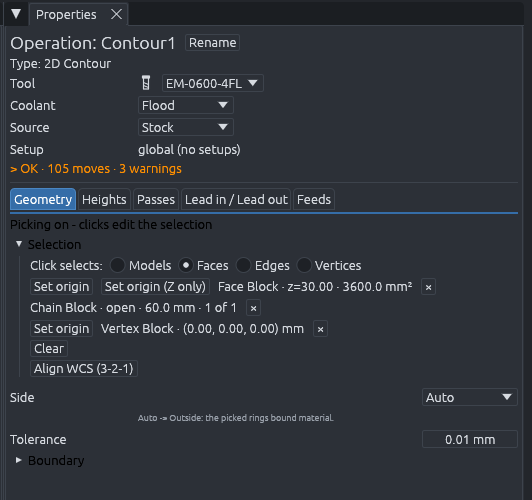
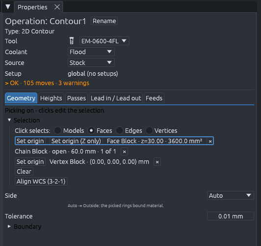

# PR #1711 row hover evidence

These captures use the shipping Geometry row drawing and real viewport pick
logic through the existing `geo_row_hover::viewport_hover_over_a_picked_face_marks_its_row`
structural test. The harness viewport is a placeholder, so the captures show
only the Geometry panel. They do not show the GPU model render.

| Pointer state | Before row outline | After row outline |
| --- | --- | --- |
| At rest |  |  |
| Over the selected top face |  |  |
| After leaving the viewport |  |  |

The before captures suppress only the new row outline while replaying the
same pointer sequence. The after captures use the unchanged PR behavior.
Capture instrumentation and suppression are temporary and are not committed.
No release snapshot goldens are changed.

The existing structural test asserts that the face row is the only marked
row, no command is queued, and leaving clears the mark. Removing the row
mark push makes it fail; restoring the push passes. Removing the frame clear
also makes it fail; restoring the clear passes.

`shell.rs` uses CRLF, matching `upstream/main`. Its content is unchanged
apart from line endings. A byte assertion comparing its CRLF and LF counts
rejects an LF-only mutation and accepts the restored file.
