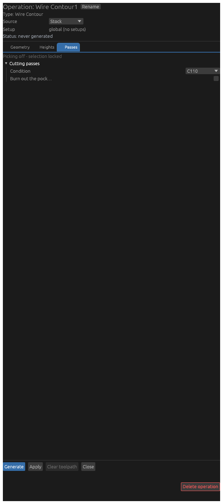
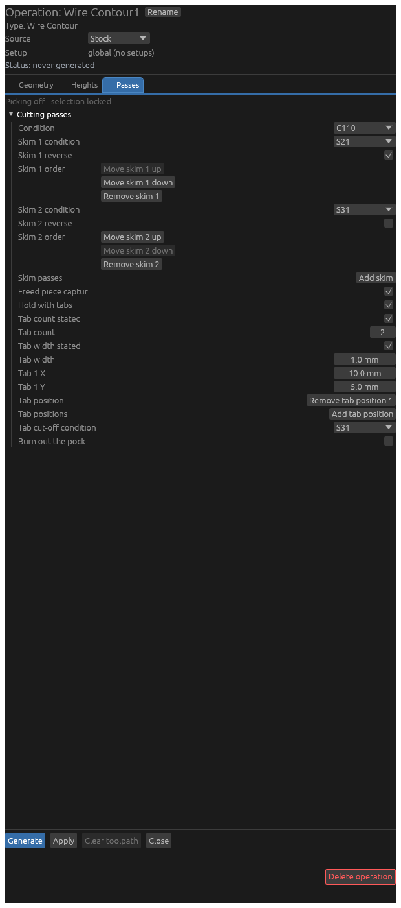

# PR #1765: Wire Contour Passes evidence

These are direct GPU renders of the real operation page using the existing
`egui_kittest` wire-machine fixture, at 620 × 1400 pixels. Both captures use
the same draft: S21 reversed, then S31; captured piece; two holding tabs,
1 mm width, position (10, 5), and S31 cut-off condition.

Before: production `wire_page.rs` from `4141eb1c`, before the PR.
After: production `wire_page.rs` from `3357737d`, the reviewed head.
The old page cannot expose the populated skim, capture, or tab draft fields.
The after image shows their controls, including skim up/down/remove actions.
No release snapshot golden was changed.

Validate the evidence with `python3 docs/review/1765/validate.py`.
