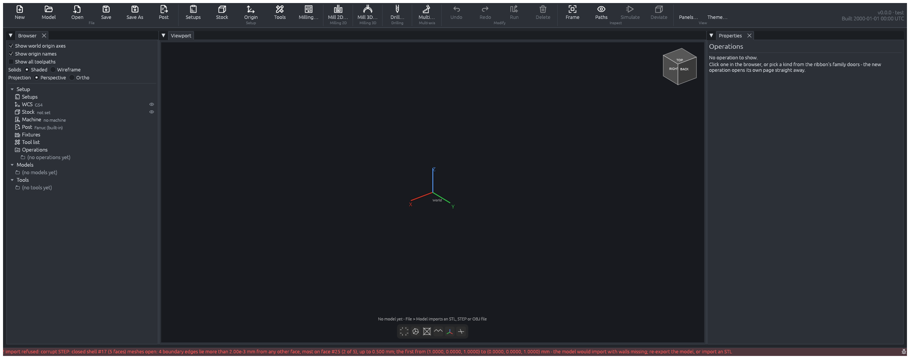
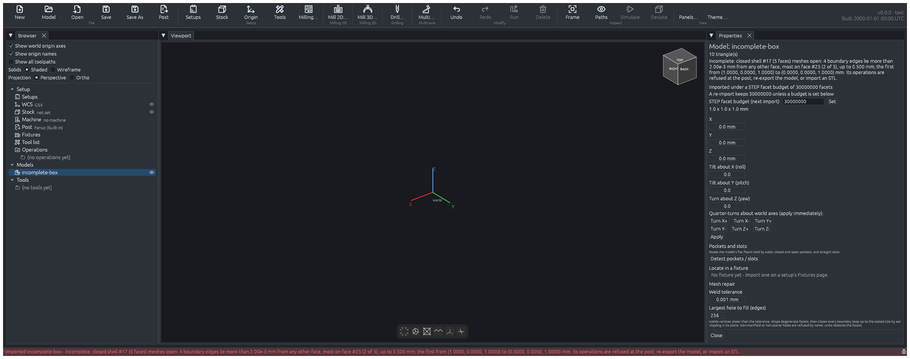

# PR #1699 UI evidence

Both images render the shipping egui shell through its existing headless
`egui_kittest` harness at 2400 × 950. The viewport is the harness's flat
placeholder; these images document the model page and import status, not
3D rendering. No pixel golden was changed.

The input is our `testdata/models/box.step` with face `#53` omitted from
closed shell `#17`, leaving five faces and a missing wall. This is the same
input used by the structural UI regression test.

## Before

The prior import entry point (`load_model_graded_within`) refuses this
closed shell because it meshes open. The document stays empty. This image
reproduces that entry point in the current harness by temporarily changing
only `ImportModel::within` to call the previous graded loader. The source
change was restored after capture.

## After

The actual current import path lands `incomplete-box`. Its model page
names the missing wall and post refusal, advises re-export or STL, and
omits the coarse-model facet-budget advice. The status strip repeats the
incomplete-model summary.

Behavior is pinned by
`incomplete_model_page_and_import_status_name_the_hole_and_post_refusal`;
these screenshots are review evidence rather than pixel assertions.
