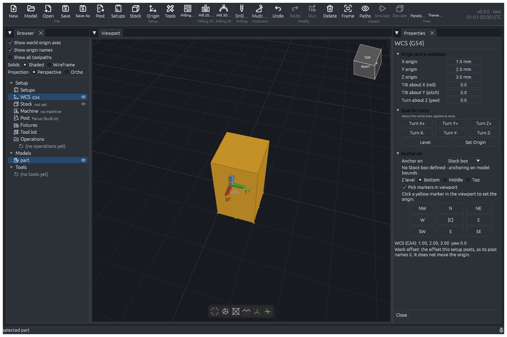
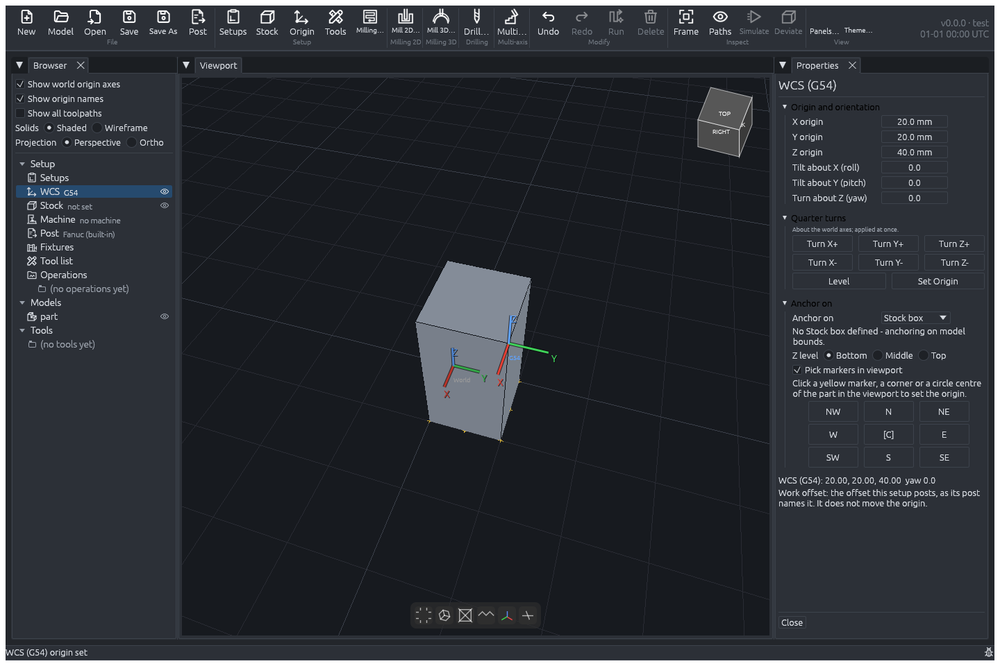
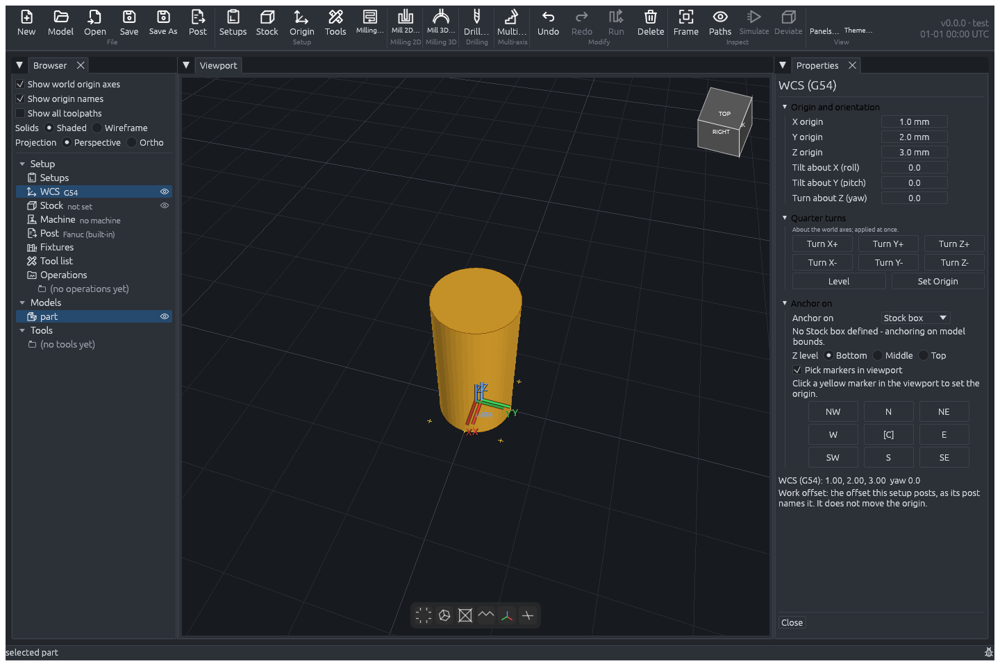
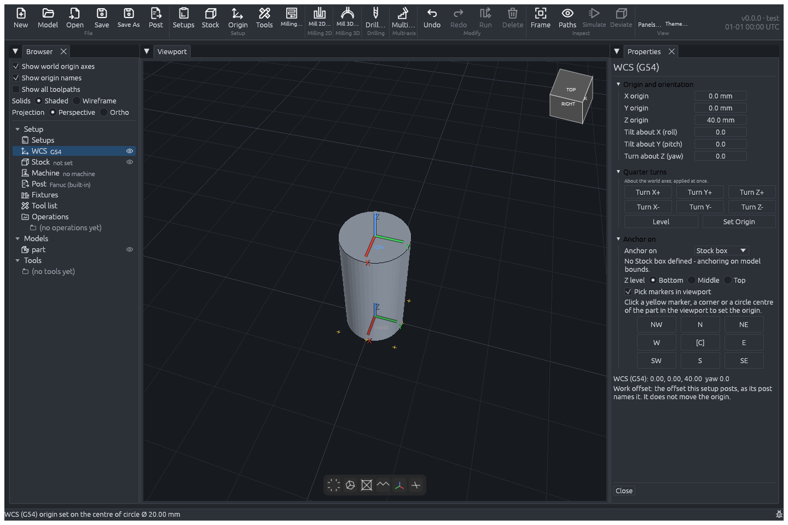

# PR #1710: WCS page and viewport evidence

These are review captures, not pixel snapshot goldens. Each image renders the
shipping WCS page and shell with a GPU-rendered `View3D` texture. No viewport
placeholder or mockup is used. The corner scene is a 20 × 20 × 40 mm block; the
centre scene is a 20 mm diameter, 40 mm high cylinder. Box markers are on the
bottom level so the clicked top corner or top rim centre misses them.

| Target | Before | After |
|---|---|---|
| Part corner (20, 20, 40) |  |  |
| Boss rim centre (0, 0, 40) |  |  |

Both versions start with WCS origin (1, 2, 3), armed **Pick markers in viewport**,
and the same camera. Each capture is taken after the same click. Before uses the
picker behavior and WCS hint from parent `101d82f9`; an unused `queue_vertex`
helper from the reviewed head remains only so the current test suite compiles.
The origin stays at (1, 2, 3). After
uses reviewed head `b3733f46c348f9146747d1d05a1cc91f4099604c`; the origin moves
to the clicked target. The WCS page readout shows the resulting position.

The ignored test
`egui_app::tests::review_1710_evidence::review_1710_wcs_page_and_viewport_evidence`
reproduces the captures. It asserts that the click misses box markers, reaches
the expected WCS origin, and leaves the WCS controls and armed hint visible.
It requires a real graphics adapter and fails explicitly without one.

From `crates/ui`, capture the current version with:

```sh
cargo test -p camcraft-ui --lib review_1710_wcs_page_and_viewport_evidence -- --ignored --nocapture
```

To reproduce the before images in a disposable worktree, save the current
`crates/ui/src/wcs_circle_pick.rs` and
`crates/ui/src/egui_app/wcs_page.rs`, replace only those two files with their
`101d82f9` versions, retaining the unused `queue_vertex` helper in the picker
so the current tests compile, and run the same command with `PR1710_BEFORE=1`. Restore
both files byte for byte afterwards. Without that environment flag, the parent
picker must make the origin assertion fail; restoring the current picker must
make it pass. The capture test writes only this evidence directory and never
updates `crates/ui/tests/snapshots/`.

If adding an environment variable prevents adapter discovery in a sandbox,
create `docs/reviews/1710/.before-capture` instead, run the unmodified capture
command, then remove that marker. The marker is never committed.
