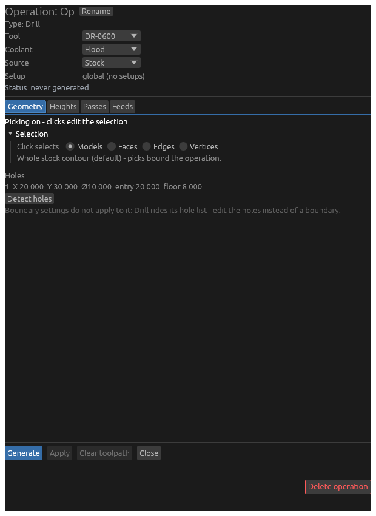
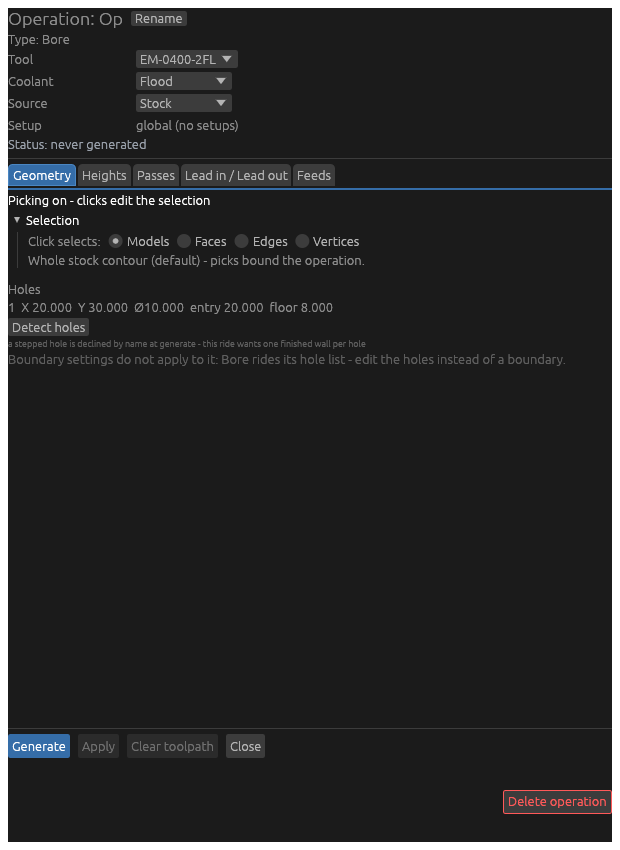
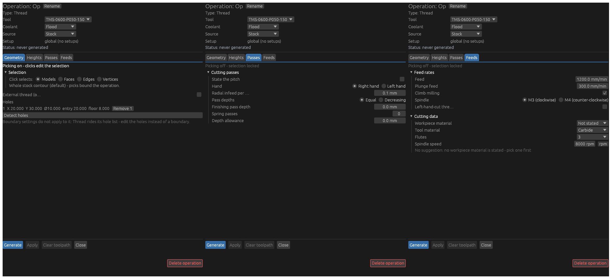

# PR #1724: hole controls before and after

These screenshots render the actual operation properties page with
`egui_kittest::Harness::render`, using identical 620-point columns, millimeter
units and one sample hole (X 20, Y 30, diameter 10, entry 20, floor 8).
Drill and Bore show Geometry. Thread shows Geometry, Passes and Feeds from
left to right, so the feature removal, hand, schedule, spring-pass and
spindle controls are visible together. These are review evidence, not
release snapshot goldens.

Before: `4a0ba90f9f09150da1e3d252a5422503f0d44b5d` versions of
`holes_page.rs` and `thread_page.rs`. After:
`e2cbcd0fef2879e158904d8f98d6b40853e82382` versions. The capture used the
same head's helpers and page shell in both cases; only those two files
were temporarily replaced for the before capture, then restored. The
capture harness was removed afterward. Each before/after pair is byte-identical:
the seam refactor changes widget routing and the spring-pass accessible
name without changing these controls' visible layout.

| Controls | Before | After |
|---|---|---|
| Drill Geometry |  |  |
| Bore Geometry |  |  |
| Thread Geometry, Passes, Feeds |  |  |

Run `python3 docs/reviews/1724/check_screenshots.py` to check the six linked
PNG files. Pass a saved PR body as an argument to check that it also embeds
all six images. This pins the review's missing-evidence finding; it does
not assert pixel equality.

The repository keeps this review evidence, following the existing checked-in
evidence in `docs/reviews/1756/`, `docs/review/1765/` and `docs/pr-1711/`.
The six images remain embedded in the PR description; this directory preserves
their capture provenance and the image-link check alongside them.
